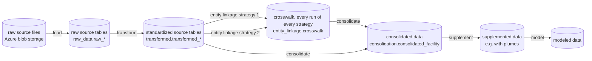

# Standardized Facility Table Specification

## Purpose

This document proposes a database schema for saving facility info from 
individual sources into a standardized form. The process for ingesting data from
a source into this standard form involves light, non-destructive transformation 
of the source data into strict units defined by this specification. The data in 
the standardized form should only include data from the source. This facilitates 
a variety of downstream merging of data from different sources. This standardized 
facility table specification refers to the "standardized source tables" in the 
flowchart below.

A secondary objective is to have a Stitch-compatible format for our source data. 
I have met with Stitch team members multiple times to review and assess if this 
format is in the right direction of being Stitch-compatible.

This document describes the specification and provides a codebook with full 
descriptions of the values, as well as other related information. Additionally, 
a [SQL template](setup/sql/create_transformed_table_template.sql) defines the 
standardized facility table structure in SQL, and every 
`transformed.transformed_<source>` table is created from it. The database 
therefore rejects an upload with a column the template does not have, a value of 
the wrong type, or a categorical value outside its allowed list. The numeric ranges in this specification are 
not enforced by the database; each transform script is responsible for them. 
Separately, [`utils/schema.py`](utils/schema.py) sets each column's default value 
and pandas dtype before upload, so a new column has to be added there as well as 
to the template and this specification. The conceptual meanings and intended 
units can not reasonsbly be 
defined in SQL, therefore this specification document defines those things 
strictly, and the onus is on each of the transoform scripts for each source to 
conform to that specification (e.g. SQL can validate that a value of `2354.67` 
is numeric, but it can not validate whether that value is in kg or tons).

It is recommended to name standardized facility tables in the form `transformed.transformed_<source>`, e.g. `transformed.transformed_usa_ghgrp`.

### process flow


### data flow



## Schema

| Field | Type | Range | Description |
|---|---|---|------------------|
| `facility_id` | text |  | source data unique ID of facility (text because some sources may use alpha-numeric IDs). Generated during transformation when the source provides none - see [Generated facility_id](#generated-facility_id). |
| `year` | integer | 1950-2080 | The year to which all non-null values in the record apply. A source record may be transformed into multiple standardized records when different measurements refer to different years. |
| `is_year_exact` | boolean |  | Indicates whether the source states the `year` that the record's values apply to, either for each value or for the whole dataset (versus a year the transform assumes because the source gives none). False if the transform assumed the year of any value on the row. |
| `facility_name` | text |  | Facility name as reported by the source. |
| `facility_name_translated` | text |  | English machine translation of `facility_name`, for sources whose names are translated before transformation. Null for every other source. |
| `operator` | text |  | Organization that runs the facility day to day, as reported by the source. |
| `iso3c_plus` | `iso3c_plus` enum |  | Country or region in which the facility is physically located, as reported or derived from the source, represented using ISO 3166-1 alpha-3 codes plus special values 'XKX' (Kosovo), 'ZNC' (Northern Cyprus), and 'UNK' (unknown). |
| `area_square_meters` | numeric |  | Surface area of the landfill footprint containing waste, expressed in square meters. |
| `facility_status` | `facility_status` enum |  | Operational status of the facility during the specified year. |
| `facility_type` | `facility_type` enum |  | Classification of the facility according to the standardized facility taxonomy. |
| `opening_year` | integer |  | Year that the facility opened as reported by the source. |
| `closing_year` | integer |  | Year that the facility closed or is expected to close, as reported by the source. |
| `has_landfill_gas_collection` | boolean |  | Indicates whether the facility has a landfill gas collection system. |
| `waste_depth` | `waste_depth` enum |  | Estimated average depth of waste during the specified `year`, as a standardized depth category. |
| `annual_incoming_waste_metric_tonnes` | numeric | ≥ 0 | Quantity of waste accepted by the facility during the specified `year`, expressed in metric tonnes. |
| `waste_in_place_metric_tonnes` | numeric | ≥ 0 | Estimated total waste mass in place during the specified `year`, expressed in metric tonnes. |
| `has_cover` | boolean |  | Indicates whether any cover material is present at the facility. |
| `cover_types` | array of `cover_type` enum |  | All cover types reported for the facility during the specified `year`. |
| `has_biocover` | boolean |  | Indicates whether the facility has a biocover, a cover layer intended to oxidize methane as it passes through. |
| `gccs_ch4_flared_metric_tonnes` | numeric | ≥ 0 | Quantity of methane routed to flaring devices by the gas collection and control system (GCCS) during the specified `year`, expressed in metric tonnes CH₄. |
| `gccs_ch4_generated_metric_tonnes` | numeric | ≥ 0 | Quantity of methane generated by the landfill during the specified `year`, expressed in metric tonnes CH₄. |
| `gccs_ch4_collected_metric_tonnes` | numeric | ≥ 0 | Quantity of methane collected by the landfill during the specified `year`, expressed in metric tonnes CH₄. |
| `gccs_lfg_collected_cubic_meters` | numeric | ≥ 0 | Volume of landfill gas (all of the gas, not only its methane) collected by the gas collection and control system (GCCS) during the specified `year`, expressed in cubic meters at 60°F (520°R) and 1 atm. It is kept as reported so the measurement is not lost when the source does not report the methane share needed to express it as `gccs_ch4_collected_metric_tonnes`. |
| `gccs_lfg_flared_cubic_meters` | numeric | ≥ 0 | Volume of landfill gas (all of the gas, not only its methane) routed to flaring devices by the gas collection and control system (GCCS) during the specified `year`, expressed in cubic meters at 60°F (520°R) and 1 atm. It is kept as reported so the measurement is not lost when the source does not report the methane share needed to express it as `gccs_ch4_flared_metric_tonnes`. |
| `gccs_lfg_generated_cubic_meters` | numeric | ≥ 0 | Volume of landfill gas (all of the gas, not only its methane) generated by the landfill during the specified `year`, expressed in cubic meters at 60°F (520°R) and 1 atm. It is kept as reported so the value is not lost when the source does not report the methane share needed to express it as `gccs_ch4_generated_metric_tonnes`. |
| `gccs_energy_project_type` | array of `gccs_energy_project_type` enum |  | Types of the landfill gas energy recovery projects associated with the facility during the specified `year`, one value per project. |
| `gccs_current_project_status` | array of `gccs_current_project_status` enum |  | Operational status of each landfill gas energy recovery project during the specified `year`, one value per project in the same order as `gccs_energy_project_type`. |
| `gccs_ch4_flow_to_project_metric_tonnes` | array of numeric | ≥ 0 | Quantity of methane routed from the gas collection and control system (GCCS) to each energy recovery project during the specified `year`, expressed in metric tonnes CH₄, one value per project in the same order as `gccs_energy_project_type`. |
| `gccs_lfg_flow_to_project_cubic_meters` | array of numeric | ≥ 0 | Volume of landfill gas (all of the gas, not only its methane) routed from the gas collection and control system (GCCS) to each energy recovery project during the specified `year`, expressed in cubic meters at 60°F (520°R) and 1 atm, one value per project in the same order as `gccs_energy_project_type`. It is kept as reported so the measurement is not lost when the source does not report the methane share needed to express it as `gccs_ch4_flow_to_project_metric_tonnes`. |
| `gccs_ch4_ratio` | numeric | 0-1 | Methane concentration of gas collected by the gas collection and control system (GCCS) during the specified `year`, expressed as a fraction between 0 and 1. |
| `gccs_collection_efficiency` | numeric | 0-1 | Fraction of the landfill gas generated during the specified `year` that is collected by the gas collection system, expressed as a value between 0 and 1. |
| `has_flare` | boolean |  | Indicates whether the facility has a flare that burns collected landfill gas. |
| `flare_efficiency` | numeric | 0-1 | Fraction of the methane sent to the flare that the flare destroys, expressed as a value between 0 and 1. |
| `oxidation` | numeric | 0-1 | Oxidation factor applied to methane emissions for the specified `year`, expressed as a value between 0 and 1. |
| `mcf` | numeric | 0-1 | Methane Correction Factor (MCF) associated with the facility for the specified year, expressed as a value between 0 and 1. |
| `latitude` | numeric | -90 to 90 | Latitude of the facility location in decimal degrees using the WGS84 coordinate reference system[^3]. Note: some sources may report the location of the facility generally and/or inaccurately, e.g. using the location of the city that the landfill serves |
| `longitude` | numeric | -180 to 180 | Longitude of the facility location in decimal degrees using the WGS84 coordinate reference system[^3]. Note: some sources may report the location of the facility generally and/or inaccurately, e.g. using the location of the city that the landfill serves |
| `point` | text | WKT `POINT` | The facility location as a Well-Known Text (WKT) point in the form `POINT(longitude latitude)` (longitude first), using the WGS84 coordinate reference system[^3]. It describes the same location as `latitude` and `longitude`, and should be null when either of them is null. |
| `is_location_exact` | boolean |  | Indicates whether the facility location specified by `latitude` and `longitude` is an exact location (versus an approximate location). |
| `ch4_emissions_metric_tonnes` | numeric | ≥ 0 | Methane emissions associated with the facility during the specified `year`, expressed in metric tonnes CH₄.|
| `food_ratio_by_weight` | numeric | 0-1 | Fraction of the facility's waste for the specified `year` attributed to food by weight. |
| `green_ratio_by_weight` | numeric | 0-1 | Fraction of the facility's waste for the specified `year` attributed to green by weight. |
| `wood_ratio_by_weight` | numeric | 0-1 | Fraction of the facility's waste for the specified `year` attributed to wood by weight. |
| `paper_cardboard_ratio_by_weight` | numeric | 0-1 | Fraction of the facility's waste for the specified `year` attributed to paper/cardboard by weight. |
| `textiles_ratio_by_weight` | numeric | 0-1 | Fraction of the facility's waste for the specified `year` attributed to textiles by weight. |
| `plastic_ratio_by_weight` | numeric | 0-1 | Fraction of the facility's waste for the specified `year` attributed to plastic by weight. |
| `metal_ratio_by_weight` | numeric | 0-1 | Fraction of the facility's waste for the specified `year` attributed to metal by weight. |
| `glass_ratio_by_weight` | numeric | 0-1 | Fraction of the facility's waste for the specified `year` attributed to glass by weight. |
| `rubber_ratio_by_weight` | numeric | 0-1 | Fraction of the facility's waste for the specified `year` attributed to rubber by weight. |
| `diaper_ratio_by_weight` | numeric | 0-1 | Fraction of the facility's waste for the specified `year` attributed to diapers by weight. |
| `sewage_sludge_ratio_by_weight` | numeric | 0-1 | Fraction of the facility's waste for the specified `year` attributed to sewage sludge by weight. |
| `other_ratio_by_weight` | numeric | 0-1 | Fraction of the facility's waste for the specified `year` attributed to other waste types not included in the above categories by weight. |
| `msw_ratio_by_weight` | numeric | 0-1 | Fraction of the facility's waste for the specified `year` that is municipal solid waste, by weight, not counting construction and demolition waste or inerts. For a source that splits its waste by class rather than by material. |
| `construction_demolition_ratio_by_weight` | numeric | 0-1 | Fraction of the facility's waste for the specified `year` that is construction and demolition waste, by weight. For a source that splits its waste by class rather than by material. |
| `inerts_ratio_by_weight` | numeric | 0-1 | Fraction of the facility's waste for the specified `year` that is inert, such as soil, rock or concrete, by weight. |
| `bulk_ratio_by_weight` | numeric | 0-1 | Fraction of the facility's waste for the specified `year` that the source reports only as bulk waste, without saying what it is: all of the waste, or whatever the source's other lines leave over. |
| `data_source` | `data_source` enum |  | Standardized identifier representing the source dataset and version from which the record was derived. |
| `created_date` | timestamp |  | Timestamp indicating when the standardized record was created. |
| `git_sha` | text |  | Git commit SHA of the ingestion and transformation code used to generate the standardized record. |

### composition columns

The `*_ratio_by_weight` columns split the facility's waste for the `year` in one of two ways.
Some sources split it by material: food, paper, wood and so on. Others split it by class:
`msw_ratio_by_weight`, `construction_demolition_ratio_by_weight` and `inerts_ratio_by_weight`.
`bulk_ratio_by_weight` holds waste a source doesn't break down. US GHGRP uses either, and can
change from year to year; it also mixes them, listing some materials and inerts and putting the
rest under bulk waste. The ratios are carried as the source files them, so a row's ratios sum
to 1 when the source's own lines do.

### database comments

When a `transformed_*` table is loaded, its column comments in the database are generated
from the Schema table above (see [`facility_etl/utils/table_comments.py`](utils/table_comments.py)),
so the wording here is what anyone, or any AI process, reading the database sees. Each comment
is the column's Description, then its Range, then the allowed values from the categorical
table of any enum named in its Type. To keep that working:

- keep the Schema table's `Field`, `Type`, `Range` and `Description` columns;
- state each numeric column's unit in its Description;
- give each enum named in the Type column a categorical table headed by its backticked name.

The exception is `data_source`: instead of every source, each table gets a table comment
naming the `data_source` value in its rows, with its description from the `data_source` table
below, so every value a transform produces must be listed there. A table's comments describe
the spec as it was when that table was loaded, and its table comment links to the spec at the
loading commit. Editing the spec does not change the comments on tables that are already loaded.

## Municipal waste only

The table is meant to describe municipal solid waste: household and similar waste. Where a
source also covers other waste, such as construction and demolition rubble, soil, industrial,
hazardous or mining waste, or sludge, the transform marks it as far as the source allows, and
taking it out is left to the model:

- A site that takes mainly other waste is typed 'Non-Municipal Waste Landfill'. It stays in the
  tables, so a model of municipal waste can leave it out.
- A site's tonnage stays as reported. Where the source shows how much of it is municipal, as
  US GHGRP's waste streams do, that split goes in the class columns (see
  [composition columns](#composition-columns)), so a model can keep only the municipal share.

## Generated facility_id

When a source provides no facility ID, the transform generates one with
`generate_facility_id` in [`facility_etl/utils/utils.py`](utils/utils.py). The
ID has the form:

```
gen_<data_source>_<facility_name>_<latitude>_<longitude>
```

- `gen_` marks the ID as generated rather than supplied by the source.
- `<data_source>` is the record's `data_source` value.
- `<facility_name>` is the source's facility name converted to snake case:
  lowercased, each run of spaces and punctuation replaced with a single
  underscore, and leading and trailing underscores removed. Accented letters
  are kept.
- `<latitude>` and `<longitude>` are the record's decimal-degree coordinates.

For example, a Waste Atlas dumpsite named 'Olusosun Dumpsite - Lagos' at 6.59,
3.37 gets `gen_waste_atlas_dumpsites_2013_olusosun_dumpsite_lagos_6.59_3.37`.

The transforms that use it are `transform_waste_atlas_dumpsites.py`,
`transform_waste_atlas_landfills.py` and `transform_kosovo_klmc.py`.

## Conversion Standards

### numeric

All numeric measurements should be converted to the following standard units during transformation.
The transform scripts take each factor from [`utils/unit_conversions.py`](utils/unit_conversions.py)
rather than writing the number inline; the Constants column names the ones each conversion uses.

| Source Unit | Standard Unit | Conversion | Constants | Notes |
|-------------|---------------|------------|-----------|------------|
| feet | meters | meters = feet × 0.3048 | `METERS_PER_FOOT` | |
| square feet | square meters | square meters = square feet × 0.092903 | | No source currently reports square feet. |
| acres | square meters | square meters = acres × 4,046.856 | `SQUARE_METERS_PER_ACRE` | |
| hectares | square meters | square meters = hectares × 10,000 | `SQUARE_METERS_PER_HECTARE` | |
| kilograms | metric tonnes | metric tonnes = kilograms ÷ 1,000 | `KILOGRAMS_PER_METRIC_TONNE` | |
| US short tons | metric tonnes | metric tonnes = US short tons × 0.907185 | `METRIC_TONNES_PER_SHORT_TON` | |
| cubic feet CH₄ | kilograms CH₄ | kg CH₄ = ft³ CH₄ × 0.0192 | `KILOGRAMS_CH4_PER_CUBIC_FOOT` | Assumes methane density = 0.0192 kg/ft³ (0.679 kg/m³), corresponding approximately to methane at 15°C and 1 atm. If different standard temperature and pressure conditions are used, the conversion factor should be adjusted accordingly.[^1]. |
| million cubic feet per day (MMCFD) | metric tonnes CH₄/year | metric tonnes CH₄/year = MMCFD × 1,000,000 × 365 × methane fraction × 0.0192 ÷ 1000 | `CUBIC_FEET_PER_MILLION_CUBIC_FEET`, `DAYS_PER_YEAR`, `KILOGRAMS_CH4_PER_CUBIC_FOOT`, `KILOGRAMS_PER_METRIC_TONNE` | |
| standard cubic feet | cubic meters | cubic meters = standard cubic feet × 0.0283168 | `CUBIC_METERS_PER_CUBIC_FOOT` | |
| million standard cubic feet per day (MMSCFD) | cubic meters/year | cubic meters/year = MMSCFD × 1,000,000 × 365 × 0.0283168 | `CUBIC_FEET_PER_MILLION_CUBIC_FEET`, `DAYS_PER_YEAR`, `CUBIC_METERS_PER_CUBIC_FOOT` | |

### categorical

Some categorical values in source data must be mapped to a standardized set of 
categories, analogous to converting numeric measurements into standardized units
(e.g., tons to kilograms). These enums define the standardized categories used 
during transformation of source data into the standardized facility schema.

"Enum" in this specification means a fixed list of allowed values, not a 
PostgreSQL enum type. Each enum column is stored as `TEXT` (or `TEXT[]` for 
arrays), and a `CHECK` constraint in the 
[SQL template](setup/sql/create_transformed_table_template.sql) rejects any value 
not in its list. The 
[consolidated facility table](setup/sql/create_consolidated_facility_table.sql) 
repeats most of these constraints, so adding a value means updating the table 
here and the matching constraint in both SQL files (the consolidated table has no 
`iso3c_plus` or `data_source` check).

For `gccs_energy_project_type` and `gccs_current_project_status`, `NULL` is also
permitted in two ways: the entire field may be `NULL`, or individual elements in
the array may be `NULL` when collapsing multiple project rows into a single
facility-year record.

`waste_depth` is the one category derived from a numeric source measurement rather
than from a source category. Convert the reported depth to meters using the numeric
conversion standards above, then assign '<=5m' or '>5m'. A reported depth of zero or
less is not a measurement, so it is left `NULL` rather than assigned to a category.

| `facility_status` |
| --- |
| 'Active' |
| 'Inactive' |

| `facility_type` |
| --- |
| 'Sanitary Landfill' |
| 'Controlled Dumpsite' |
| 'Dumpsite' |
| 'Incineration Facility' |
| 'Transfer Station' |
| 'Recycling Center' |
| 'Not a Waste Facility' |
| 'Non-Municipal Waste Landfill' |

Three `facility_type` values name sites where no waste is disposed of:

- 'Transfer Station': collected waste is gathered there and sent on for disposal elsewhere.
- 'Recycling Center': recyclables are dropped off, sorted or recovered there.
- 'Not a Waste Facility': the site never was a waste site, for example a quarry or a snow dump.

A site that does both of the first two is a 'Transfer Station' if it takes mixed waste, and a
'Recycling Center' only if it takes nothing but separated recyclables. A transfer station or
recycling center built on a closed landfill is classified as the landfill.

'Non-Municipal Waste Landfill' is a disposal site that takes mainly waste other than municipal
solid waste, such as construction and demolition rubble, soil, or industrial, hazardous or mining
waste. See [Municipal waste only](#municipal-waste-only).

| `waste_depth` |
| --- |
| '<=5m' |
| '>5m' |

| `cover_type` |
| --- |
| 'clay cover' |
| 'organic cover' |
| 'sand cover' |
| 'other soil mixture' |

| `gccs_energy_project_type` |
| --- |
| 'Electricity Generation' |
| 'Direct Use' |
| 'Renewable Natural Gas' |
| 'Other' |
| `NULL` |

| `gccs_current_project_status` |
| --- |
| 'Operational' |
| 'Under Construction' |
| 'Planned' |
| 'Closed' |
| `NULL` |

### `iso3c_plus`

all [valid ISO 3166-1 alpha-3 codes](https://www.iso.org/iso-3166-country-codes.html)[^2] plus `XKX` for Kosovo, `ZNC` for Northern Cyprus, and `UNK` for unknown

### `data_source`

| `data_source` | Source | Link |
| --- | --- | --- |
| 'usa_ghgrp_2026' | EPA GHGRP data from 2026 | |
| 'canada_ghgrp_2021' | Canada GHGRP data from 2021 | |
| 'eprtr_2022' | EPRTR methane data through 2022 | |
| 'gpw_2021' | Global Plastic Watch landfill inventory snapshot for 2021 | |
| 'mexico_inegi_2016' | Mexico INEGI landfill dataset for 2016 | |
| 'osm_2022' | OpenStreetMap-derived landfill inventory snapshot for 2022 | |
| 'waste_atlas_dumpsites_2013' | Waste Atlas dumpsites dataset for 2013 | |
| 'waste_atlas_landfills_2013' | Waste Atlas landfills dataset for 2013 | |
| 'lmop_2024' | EPA LMOP data from 2024 | [Direct Download](https://www.epa.gov/system/files/documents/2024-09/lmopcompositedata.xlsx) |
| 'sinir_2024' | SINIR (Brazilian government waste data) landfill/facility dataset, pulled 2024 | |
| 'legacy_manual_entry' | Facilities entered by hand into the production database with no upstream source. Carries no year suffix because the entry year varies per row - see the `year` column, which is sourced per row from the entry timestamp. | |
| 'manual_entry' | Records maintained by hand in this repo's `raw_ingestion/manual_data/manual_entry_facilities.csv`: corrections to facilities other sources report, and facilities added by hand that no source reports. Carries no year suffix because the year varies per row - see the `year` column, which is the row's data collection year where it has one and its entry year otherwise. | |
| 'kosovo_klmc_2026' | Kosovo disposal site data from the Kosovo Landfill Management Corporation (KLMC), shared with RMI via GIZ in 2026 on RMI's own site-level data collection template. The year suffix is the year we received the submission; the waste quantities it reports are for 2025 (see the `year` column). | |
| 'ai_search_2026' | Facility attributes found by RMI's AI facility search, which searches the web for each facility (repository `RMI/waste-ai-search`), run in 2026. | |
| 'imeo_site_review_2026' | UNEP International Methane Emissions Observatory (IMEO) review of the Climate TRACE landfills estimated to emit over one tonne of methane an hour, checked against satellite imagery and shared with RMI in 2026. Carries only IMEO's judgement of what each site is (`facility_type`, and `facility_status` and `has_cover` for sites found closed and covered); `facility_id` is the Climate TRACE source ID. The year suffix is the year we received the review; `year` is the Climate TRACE inventory year it checked. | |

## Run Provenance

`git_sha` and `created_date` together record which run produced a row. Both are
stamped in `facility_etl/transform/run_all_transformation_uploads.py`, resolved once
per run so every `transformed_*` table in that run shares the same pair.

`git_sha` comes from `get_git_sha()` in `facility_etl/utils/utils.py`, which is
`git rev-parse HEAD` against the repository root - the commit checked out on the
machine that ran the transform. It is not read from `main` or from any remote. If the
working tree has uncommitted changes the value carries a `-dirty` suffix, because HEAD
alone would then name code that is not what actually ran.

Neither column can be populated by a Postgres column default. The load path uses
`df.to_sql(..., if_exists="append")`, which names every column in the INSERT, and an
explicit NULL takes precedence over a column default. We could change this to default `NOW()`, but for now `created_date` is stamped in Python so that it stays consistent with
`git_sha` and with how `entity_linkage` stamps the same pair.

### running against a traceable commit

This repository squash-merges pull requests, so a branch commit does not survive the
merge under the same SHA - the squash lands on `main` as a new commit with a different
SHA than what is on local. A row stamped during local development therefore carries a SHA that never appears
on `main`, and which becomes unreachable once the branch is deleted.

Development and testing runs are expected to carry these throwaway (often `-dirty`)
SHAs. Any load whose provenance needs to stay resolvable should be run from a clean,
freshly pulled checkout of `main` after the merge, so it picks up the squashed commit:

```bash
git switch main
git pull
# then run the transform loads
```

## Examples

### year transform example

source data:

| `facility_id` | `reporting_year` | `waste_in_place_metric_tons` | `waste_in_place_year` | `ch4_emissions_metric_tonnes` | `emissions_year` |
|----|----|----|----|----|----|
| 123456 | 2024 | 3454.34 | 2023 | 0.57 | 2022 |

standardized:

| `facility_id` | `year` | `waste_in_place_metric_tons` | `ch4_emissions_metric_tonnes` |
|----|----|----|----|
| 123456 | 2023 | 3454.34 | null |
| 123456 | 2022 | null | 0.57 |

### example standardized facility table with two records

| Field | Record 1 | Record 2 |
|---------------------------|----------------------|----------------------|
| `facility_id` | US425443 | US425443 |
| `year` | 2024 | 2025 |
| `is_year_exact` | True | True |
| `facility_name` | 'ABC Regional Landfill' | 'ABC Regional Landfill' |
| `operator` | 'ABC Waste Services' | 'ABC Waste Services' |
| `iso3c_plus` | 'USA' | 'USA' |
| `area_square_meters` | 2345000 | 2345000 |
| `facility_status` | 'Active' | 'Active' |
| `facility_type` | 'Sanitary Landfill' | 'Sanitary Landfill' |
| `opening_year` | 1998 | 1998 |
| `closing_year` | 2045 | 2045 |
| `has_landfill_gas_collection` | True | True |
| `waste_depth` | '>5m' | '>5m' |
| `annual_incoming_waste_metric_tonnes` | 343453 | 363472 |
| `waste_in_place_metric_tonnes` | 9028420 | 9381892 |
| `has_cover` | True | True |
| `cover_types` | ['clay cover', 'sand cover'] | ['clay cover', 'sand cover'] |
| `has_biocover` | False | False |
| `gccs_ch4_flared_metric_tonnes` | 5100 | 5470 |
| `gccs_ch4_generated_metric_tonnes` | 65000 | 69960 |
| `gccs_ch4_collected_metric_tonnes` | 57000 | 59660 |
| `gccs_lfg_collected_cubic_meters` | 161700000 | 166000000 |
| `gccs_lfg_flared_cubic_meters` | 14460000 | 15220000 |
| `gccs_lfg_generated_cubic_meters` | 184400000 | 194700000 |
| `gccs_energy_project_type` | ['Electricity Generation'] | ['Electricity Generation'] |
| `gccs_current_project_status` | ['Operational'] | ['Operational'] |
| `gccs_ch4_flow_to_project_metric_tonnes` | [43000] | [47000] |
| `gccs_lfg_flow_to_project_cubic_meters` | [121960000] | [130790000] |
| `gccs_ch4_ratio` | 0.52 | 0.53 |
| `gccs_collection_efficiency` | 0.74 | 0.75 |
| `has_flare` | True | True |
| `flare_efficiency` | 0.98 | 0.98 |
| `oxidation` | 0.10 | 0.10 |
| `mcf` | 1.00 | 1.00 |
| `latitude` | 41.8781 | 41.8781 |
| `longitude` | -87.6298 | -87.6298 |
| `point` | 'POINT(-87.6298 41.8781)' | 'POINT(-87.6298 41.8781)' |
| `is_location_exact` | True | True |
| `ch4_emissions_metric_tonnes` | 14500 | 13800 |
| `food_ratio_by_weight` | 0.22 | 0.21 |
| `green_ratio_by_weight` | 0.10 | 0.10 |
| `wood_ratio_by_weight` | 0.08 | 0.08 |
| `paper_cardboard_ratio_by_weight` | 0.24 | 0.24 |
| `textiles_ratio_by_weight` | 0.07 | 0.07 |
| `plastic_ratio_by_weight` | 0.15 | 0.16 |
| `metal_ratio_by_weight` | 0.04 | 0.04 |
| `glass_ratio_by_weight` | 0.03 | 0.03 |
| `rubber_ratio_by_weight` | 0.02 | 0.02 |
| `diaper_ratio_by_weight` | null | 0.02 |
| `sewage_sludge_ratio_by_weight` | null | null |
| `other_ratio_by_weight` | 0.05 | 0.05 |
| `msw_ratio_by_weight` | null | null |
| `construction_demolition_ratio_by_weight` | null | null |
| `inerts_ratio_by_weight` | null | null |
| `bulk_ratio_by_weight` | null | null |
| `data_source` | 'ghgrp_2026' | 'ghgrp_2026' |
| `created_date` | 2026-05-12 14:22:31 | 2026-05-12 14:22:31 |
| `git_sha` | d14d37587b08183a959d3ba7225869916a1370a1 | d14d37587b08183a959d3ba7225869916a1370a1 |

## References and Sources

[^1]: [GHG Manuscript Supporting Information](https://pasteur.epa.gov/uploads/10.23719/1518680/GHG%20Manuscript%20Supporting%20Information.docx?utm_source=chatgpt.com)
[^2]: [ISO 3166-1 country codes](https://www.iso.org/iso-3166-country-codes.html)
[^3]: [WORLD GEODETIC SYSTEM 1984 (WGS 84)](https://earth-info.nga.mil/index.php?dir=wgs84&action=wgs84)
